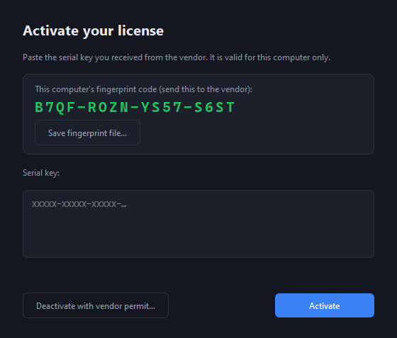
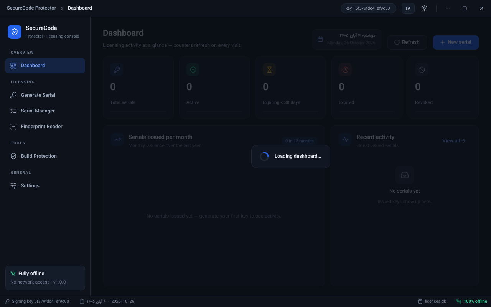
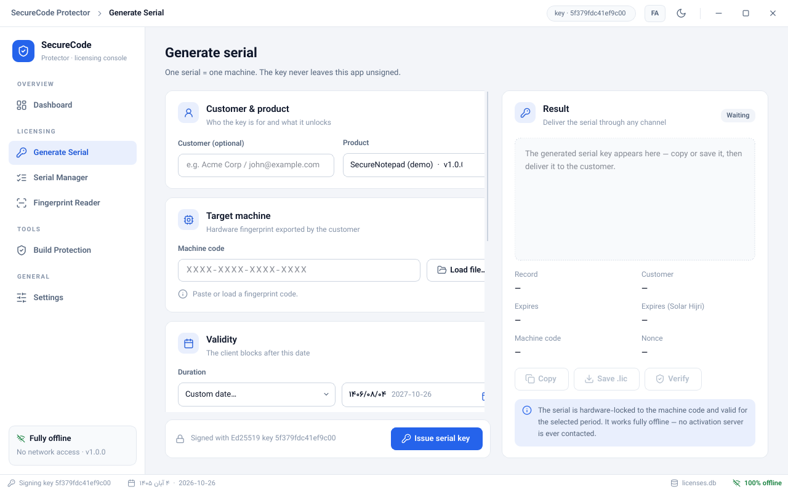

<div dir="rtl" align="right">

# 🛡️ SecureCode

**سیستم حفاظت از کد پایتون + لایسنس‌سازی کاملاً آفلاین، قفل‌شده روی سخت‌افزار**

سریال‌های صادرشده توسط «محافظ» روی **یک سیستم مشخص** فعال می‌شوند، مدت‌دار هستند (مثلاً یک سال) و **بدون هیچ اتصال اینترنتی** کار می‌کنند — نه سرور، نه فعال‌سازی آنلاین، نه تله‌متری.

</div>

---

<div dir="rtl" align="right">

## 🎯 این پروژه چیست؟

| بخش | توضیح |
|---|---|
| **محافظ (Protector)** | نرم‌افزار دسکتاپ PySide6 با GUI تجاری (تم تیره/روشن، فارسی/انگلیسی، تاریخ جلالی) برای صدور سریال، مدیریت لایسنس‌ها، خواندن اثر انگشت سخت‌افزار و تولید اسکریپت بیلد |
| **لایسنس‌دهی آفلاین** | امضای دیجیتال **Ed25519** — کلید خصوصی فقط دست شماست؛ حتی با مهندسی معکوس کامل EXE، ساخت سریال جعلی ممکن نیست |
| **محافظت از کد** | کامپایل با **Nuitka** (پایتون → C → کد ماشین) — هیچ بایت‌کد `.pyc` وجود ندارد، پس pyinstxtractor / uncompyle6 / pycdc هیچ چیزی برای بازکردن پیدا نمی‌کنند |
| **SDK چندپلتفرمی** | همان سریال‌ها روی **اندروید (Kotlin/Java/Flutter)**، **iOS** و **macOS** هم تأیید می‌شوند — فرمت سیم مو‌به‌مو یکسان بازتولید شده |

## 📸 پیش‌نمایش

| صفحه فعال‌سازی | داشبورد تیره | ساخت سریال |
|---|---|---|
|  |  |  |

نمایش‌های بیشتر در پوشه [`demo-run/`](demo-run/) — شامل هر ۶ صفحه در تم تیره/روشن و فارسی/انگلیسی.

## 🏗️ ساختار پروژه

```
securecode/
├── protector/      # 🛠️ سازنده سریال (GUI — PySide6، ۶ صفحه، دوزبانه)
├── target_demo/   # 🎯 SecureNotepad — دموی محافظت‌شده + SDK سمت کلاینت
│   └── protection/ #    ضد دیباگر، اثر انگشت، ضد تقلب ساعت، یکپارچگی...
├── shared/        # 🔐 فرمت سیم مشترک (payload, codec, secure buffer)
├── sdks/          # 📱 SDKهای بومی: Apple (Swift)، Flutter، Android (Kotlin)
├── tests/         # ✅ تست‌های e2e، بردارهای کراس‌پلتفرم، تست UI
├── docs/          # 📚 SECURITY، WORKFLOW، INTEGRATION، PLATFORMS...
└── build*.bat/.sh # 🔨 اسکریپت‌های بیلد با Nuitka
```

## 🚀 شروع سریع

```bash
pip install -r requirements.txt

# اجرای محافظ (سازنده سریال)
python -m protector.main

# اجرای دموی محافظت‌شده (کلاینت لایسنس)
python -m target_demo.main
```

اولین اجرای محافظ: رمز keystore بسازید (همان رمزی که همه سریال‌های شما را امضا می‌کند) → **فوراً از Settings یک بکاپ کلید خصوصی بگیرید** (جزئیات در [`docs/WORKFLOW.md`](docs/WORKFLOW.md)).

برای بیلد EXE محافظت‌شده در ویندوز: `build.bat` (نیازمند Nuitka — یک‌بار برای دانلود toolchain اینترنت می‌خواهد؛ خود برنامه ساخته‌شده کاملاً آفلاین است).

## 🔐 معماری امنیتی — ۵ لایه

1. **Nuitka** — کامپایل بومی؛ زنجیره حمله extract+decompile کاملاً مرده است
2. **رشته‌های رمزنگاری‌شده** — AES-GCM با کلید زمان اجرا
3. **ضد دیباگر** — IsDebuggerPresent، تشخیص IDA/x64dbg/Ghidra، تشخیص زمانی
4. **یکپارچگی خود** — منیفست SHA-256 از ماژول‌های خودی
5. **بهداشت حافظه** — پاک‌سازی بافرها، keystore فقط در RAM

مدل تهدید صادقانه (چه چیزی جلوگیری می‌شود، چه نمی‌شود): [`docs/SECURITY.md`](docs/SECURITY.md) · ممیزی امنیتی: [`docs/SECURITY_AUDIT_2026-10-28.md`](docs/SECURITY_AUDIT_2026-10-28.md)

## 🔄 چرخه کار با مشتری (۱۰۰٪ آفلاین)

```
مشتری نصب می‌کند → «کد ماشین» را برای شما می‌فرستد (فایل/ایمیل)
→ شما در محافظ سریال ۱ ساله برای آن ماشین می‌سازید
→ مشتری سریال را وارد می‌کند → فقط روی همان سیستم فعال ✅
```

راهنمای کامل: [`docs/WORKFLOW.md`](docs/WORKFLOW.md) · ادغام با پروژه خودتان: [`docs/INTEGRATION.md`](docs/INTEGRATION.md)

## 📚 مستندات

| سند | محتوا |
|---|---|
| [docs/SECURITY.md](docs/SECURITY.md) | مدل تهدید، لایه‌ها، ریسک‌های باقی‌مانده |
| [docs/WORKFLOW.md](docs/WORKFLOW.md) | راهنمای عملیاتی روزانه فروشنده |
| [docs/INTEGRATION.md](docs/INTEGRATION.md) | اضافه‌کردن لایسنس به پروژه خودتان |
| [docs/PLATFORMS.md](docs/PLATFORMS.md) | پشتیبانی ویندوز/اندروید/iOS/macOS |
| [DECISIONS.md](DECISIONS.md) | تصمیم‌های فنی پروژه |
| [docs/ICON.md](docs/ICON.md) | مشخصات آیکون و فایل‌های آن |

## ⚠️ هشدار کلید خصوصی

کلید خصوصی Ed25519 فقط داخل keystore رمزنگاری‌شده محافظ زندگی می‌کند. **اگر گم شود، هیچ سریالی قابل تمدید نیست.** بکاپ آفلاین (USB در جای امن) الزامی است — [`docs/WORKFLOW.md`](docs/WORKFLOW.md).

</div>

---

<div align="center">

**English summary** — SecureCode is an offline, hardware-locked licensing & code-protection suite for Python apps: a PySide6 serial-generator (bilingual FA/EN, dark/light, Jalali calendar), an Ed25519-signed offline license format verified byte-for-byte identically by native SDKs (Android/iOS/macOS/Flutter), and a Nuitka-based build pipeline that leaves no `.pyc` bytecode for extractors/decompilers to attack. Fully offline by design — no servers, no telemetry, ever.

*See [`docs/PLATFORMS.md`](docs/PLATFORMS.md) for English details.*

</div>
